# worker-makers

어떤 프로젝트에서도 요구 정제부터 상세 계획, 직렬·병렬 개발까지 연결하는 Codex·Claude Code 스킬 도구함입니다.

[개발자 홈페이지](https://housney.me)

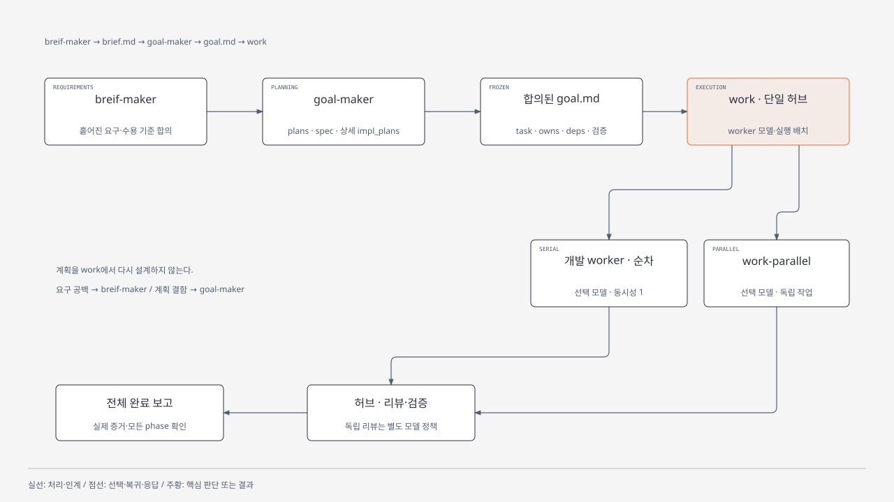

| 스킬 | 책임 |
|---|---|
| `breif-maker` | 흩어진 요구를 목적·범위·비목표·수용 기준·합의 근거가 명확한 `brief.md`로 정리 |
| `goal-maker` | 실제 조사 → plans 수렴 → spec 수렴 → 매우 상세한 impl_plans 수렴 → goal 인계 |
| `work` | 합의된 goal 실행, 개발 모델 정책, 허브 운영, 코드·보안 리뷰, 검증·완료 |
| `work-parallel` | 같은 work 허브의 독립 task 배치·회수·직렬 통합. 별도 허브를 만들지 않음 |

`breif-maker`는 확정된 이름이고 산출물은 `brief.md`입니다. 계획 중 요구 의문은 goal-maker가 breif-maker의 질의응답 모드로 근거를 확인하고, 필요한 사용자 선택만 질문합니다.

goal-maker는 합의 목표를 충족하는 최소 변경을 계획합니다. 각 기술 결정에 재사용 판정을 남기고, 신규 구조·의존성은 실제 후보와 변경·회귀·운영 부담을 비교해 필요성이 입증될 때만 도입합니다. 미래 확장이나 인접 정리를 이유로 범위를 늘리지 않으며 phase·검증은 실제 의존성과 완료 기준에 대응해야 합니다. 상세 impl-plan은 구현을 복잡하게 만드는 대신 worker가 판단을 추측할 여지를 줄입니다.

## 워크플로우

요구 합의는 breif-maker, 기술 계획은 goal-maker, 개발 실행과 완료 판정은 work가 담당합니다. 세부 흐름은 아래에서 펼쳐 볼 수 있습니다.

<details>
<summary>요구 정제·계획 작성·질문 해소·수렴 루프</summary>

### 요구 정제

기존 합의를 재사용하고, 필요한 선택만 확인해 brief로 정리합니다. 타당성 조사만 요청한 경우에는 조사 결과로 마칩니다.

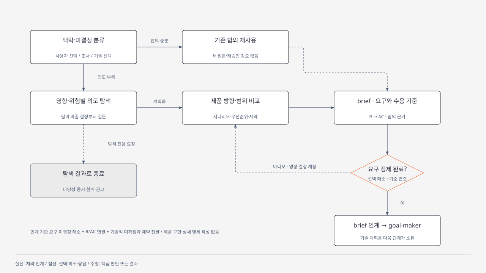

### 순차 계획 파이프라인

plans가 수렴한 뒤 spec, spec이 수렴한 뒤 상세 impl_plans를 작성합니다. 단계 내부의 독립 작성·리뷰는 병렬로 진행할 수 있습니다. 신규 도입에는 재사용 판정과 비교 근거가 필요합니다.

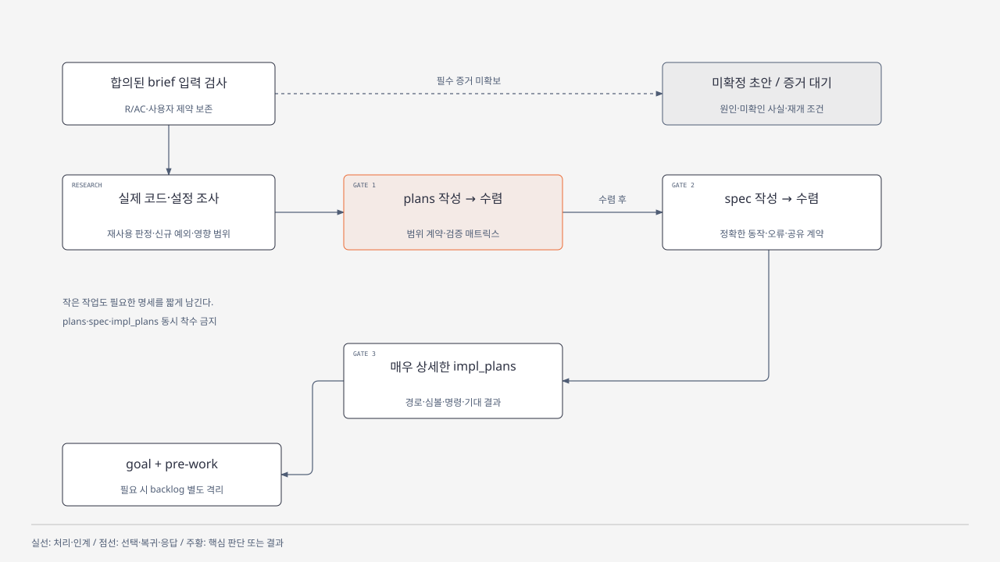

### 계획 중 질문 해소

기술 판단은 goal-maker가 조사하고, 요구 의문은 breif-maker가 기존 근거를 확인합니다. 새 사용자 결정이 필요하면 허브가 질문하고, 답변 후 영향 계획부터 재개합니다.

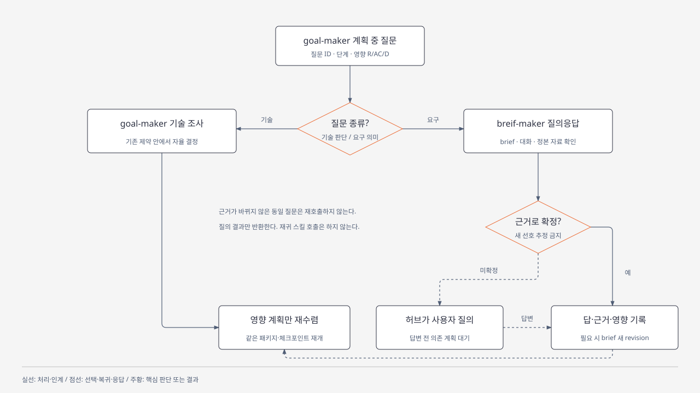

### 관점별 리뷰와 수렴

정합성·최소성·완결성·구현가능성을 검토합니다. 목표에 불필요한 확장은 backlog로 분리하고, 필요한 수정과 계약 보정을 마친 뒤 다음 단계로 넘깁니다.

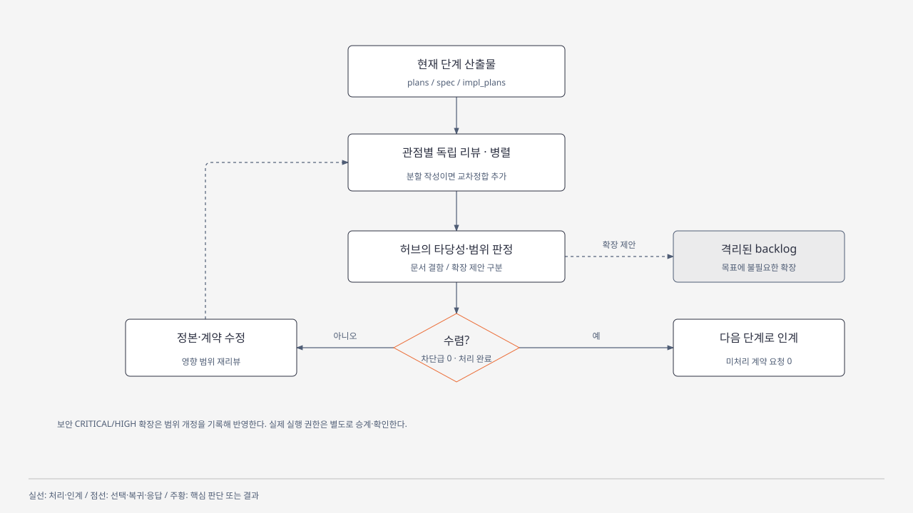

</details>

<details>
<summary>work 실행 분기·개발 모델 선택·병렬 통합</summary>

### goal 인계부터 전체 완료까지

허브는 합의된 goal과 선행조건을 확인하고 개발 worker의 모델을 정합니다. 직렬·병렬 실행 모두 개발 worker에게 위임하며, 통합 결과의 리뷰·검증과 다음 phase 진행은 같은 허브가 관리합니다.

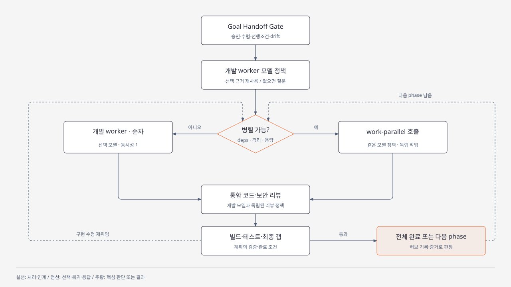

### worker 모델 정책

이번 호출의 명시 옵션, 동일 run의 기록, 사용자가 저장한 기본값 순으로 확인하고 없을 때만 한 번 질문합니다. 모델·reasoning·동시성·승격 권한을 따로 관리하며 허브 모델은 유지합니다.

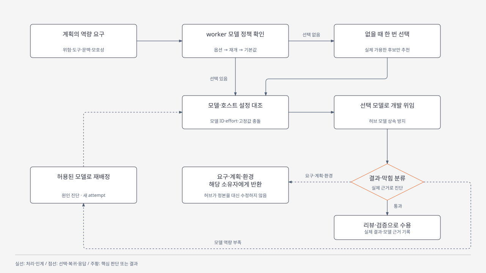

### 병렬 실행과 직렬 통합

통합된 deps와 phase gate를 만족하고 owns·자원이 충돌하지 않는 task만 동시에 시작합니다. 결과 메시지 외에 실제 종료·diff·현재 attempt·커밋 또는 파일 지문을 확인하고, 저장소별로 한 건씩 통합합니다.

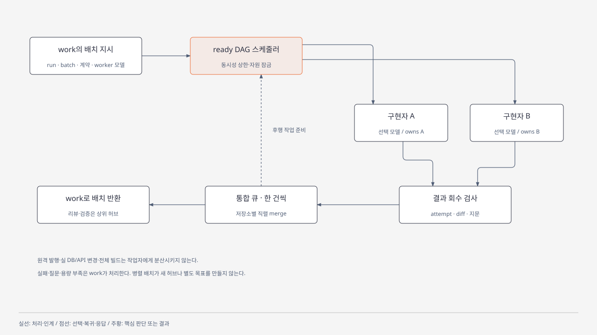

</details>

<details>
<summary>허브 통신·태스크 상태·공유 계약 의존</summary>

### 하나의 허브에서 질문과 결과 수집

worker는 지정한 task를 수행하고 질문·결과를 허브에 반환합니다. 필요한 사용자 결정과 중앙 원장 갱신, 최종 보고는 work가 맡습니다.

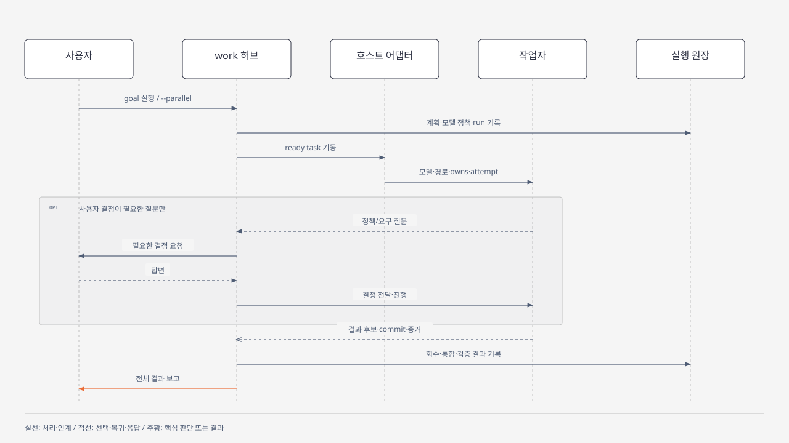

### 준비·실행·보고·통합 상태

준비 intent를 먼저 기록하고 사본과 packet을 확정한 뒤 worker를 기동합니다. preparing에서 중단되면 같은 attempt로 이어가며, 검사된 결과도 실제 통합이 끝나야 merged가 됩니다. 실패와 통합 충돌은 원인·현재 상태를 확인한 뒤 재시도합니다.

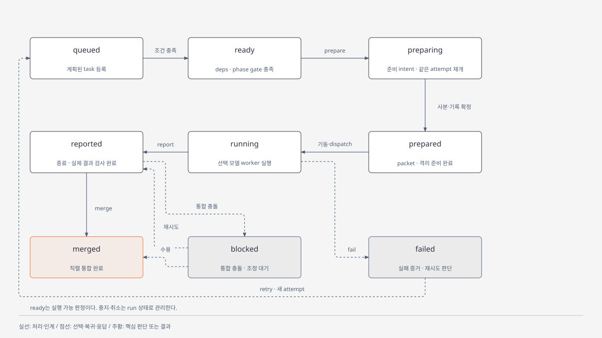

### 공유 계약이 있는 작업의 병렬 경계

공유 계약을 먼저 고정하고 독립 구현을 병렬로 진행합니다. 소비자의 실제 계약 통합은 제공자 결과와 계약 수용을 확인한 뒤 시작합니다.

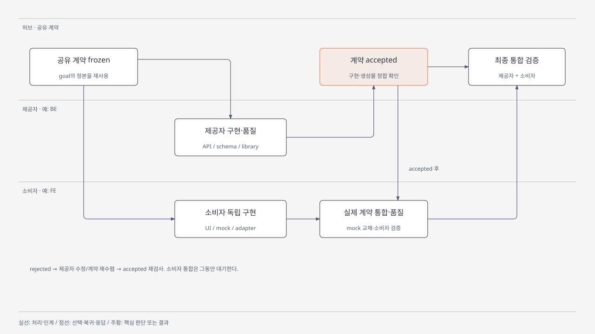

</details>

## 요구 환경

- 다음 중 하나의 호스트
  - 스킬·로컬 플러그인·프로젝트 설정을 지원하는 Codex. CLI 설치/탐색 검증 버전은 **0.164.0**입니다.
  - 플러그인을 지원하는 Claude Code. 설치와 스킬 탐색 검증 버전은 **2.1.314**입니다.
- Python **3.11+**: 외부 패키지나 `npm install`은 필요하지 않습니다.
- Git 프로젝트는 branch/worktree, non-Git·최초 커밋 없는 프로젝트는 files 스냅샷을 사용합니다. 파일 사본과 백업을 저장할 로컬 파일 시스템은 hard link를 지원해야 합니다. 제품 언어/프레임워크는 제한하지 않습니다.
- 개발 worker 실행: 명시적 모델·작업 경로·결과/종료를 관리할 수 있는 호스트의 하위 에이전트 기능이 필요합니다. 모델 지정이 불가능하면 개발 기동을 보류합니다. Claude Code는 하위 에이전트에 cwd 인자가 없어 [호스트 규약](skills/work/references/host-model.md)대로 절대경로로 지시하고 결과를 검사합니다.

## Claude Code — 플러그인

저장소를 마켓플레이스로 등록하고 설치합니다. 현재 프로젝트에만 쓰려면 `--scope local`을 붙입니다. 생략하면 사용자 전체에 적용됩니다.

```powershell
claude plugin marketplace add housneypro/worker-makers --scope local
claude plugin install worker-makers@worker-makers --scope local
```

이미 clone했다면 경로로 등록할 수 있습니다. 이 경우 플러그인을 clone 위치에서 직접 읽으므로 수정 내용이 다음 세션이나 `/reload-plugins` 후 바로 반영됩니다.

```powershell
claude plugin marketplace add ./worker-makers --scope local
claude plugin install worker-makers@worker-makers --scope local
```

설치 후 새 세션을 열어 `/plugin` 또는 `claude plugin details worker-makers`로 확인합니다. 팀원과 함께 쓰려면 `--scope project`로 등록해 `.claude/settings.json`을 커밋합니다. 제거는 `claude plugin uninstall worker-makers@worker-makers --scope local`입니다.

호출 이름과 옵션은 [사용](#사용)을 따릅니다.

## Codex Project scope — 플러그인

**대상 제품 프로젝트 root**에서 실행합니다.

```powershell
git clone https://github.com/housneypro/worker-makers.git
python -X utf8 worker-makers/scripts/install-project.py --project .
```

설치기는 프로젝트 내부의 플러그인·스킬·bundle을 확인하고 `.agents/plugins/marketplace.json`, `.codex/config.toml`에 프로젝트 marketplace·활성화를 병합합니다. 기존 설정과 주석을 보존하며 복합 TOML을 안전하게 변경할 수 없으면 중단합니다.

격리된 임시 Codex home에서 공식 CLI로 설치 캐시를 만들고 `distribution.json`의 허용 파일만 사용자 Codex 캐시에 배치합니다. **사용자 전역 `config.toml`은 수정하지 않습니다.** 동일 버전 캐시는 내용이 같을 때만 재사용합니다. 내용이 다르면 활성 실행을 덮어쓰지 않고 중단합니다.

제품 프로젝트를 신뢰한 상태로 새 Codex 대화를 열어 스킬을 확인합니다. 호스트 캐시의 물리 위치와 프로젝트별 활성화 범위는 다릅니다. [공식 플러그인 패키징·프로젝트 활성화](https://developers.openai.com/plugins/build/plugins)

```powershell
python -X utf8 worker-makers/scripts/install-project.py --project . --dry-run
python -X utf8 worker-makers/scripts/install-project.py --project . --register-only
```

`--dry-run`은 변경 없이 검사합니다. `--register-only`는 캐시 없이 설정만 등록합니다. 설치 실패 시 오류를 확인하고 재실행하며 설정 등록만으로 스킬 사용이 확인됐다고 판단하지 않습니다. 프로젝트를 이동하면 기존 marketplace source의 절대경로를 새 root로 조정해야 합니다.

## Codex User scope — skill-installer

여러 프로젝트에서 개인 스킬로 쓰려면 Codex에 요청합니다.

```text
$skill-installer https://github.com/housneypro/worker-makers.git
skills/breif-maker, skills/goal-maker, skills/work, skills/work-parallel을 user scope로 설치해줘.
```

installer의 기본 `$CODEX_HOME/skills`에 개별 스킬을 설치하며 플러그인은 등록하지 않습니다. 각 스킬은 필요한 지침·reference·template·Python 도구를 포함해 plugin manifest 없이 사용할 수 있습니다. 두 방식은 같은 `skills/` 원본을 사용합니다.

두 방식이 함께 발견되면 하나의 bundle을 선택합니다. 다른 버전의 스킬/도구를 같은 run에 혼용하지 않습니다. 사용자 설치의 기존 폴더는 installer가 자동 덮어쓰지 않습니다.

## 사용

플러그인에서 확인한 호출 이름은 `worker-makers:<skill-name>`입니다. Claude Code에서는 아래 표기의 `$`를 `/`로 바꿉니다.

```text
$worker-makers:breif-maker <정리할 요구>
$worker-makers:goal-maker --from-brief <WORK_ROOT>/brief.md
$worker-makers:work --from-goal <WORK_ROOT>/goal.md
```

```text
/worker-makers:work --from-goal <WORK_ROOT>/goal.md --worker-model sonnet
```

Claude Code의 `--worker-model`에는 하위 에이전트 모델 값인 `haiku`, `sonnet`, `opus`, `fable`을 씁니다.

user scope는 `$breif-maker`, `$goal-maker`, `$work`로 호출합니다. 자연어로 역할을 요청해도 됩니다. `work` 단독 호출은 연결된 활성 run이나 유일한 합의 goal을 사용하며 임의로 최신 파일을 선택하지 않습니다.

```text
$worker-makers:work --from-goal <goal.md> --worker-model <개발-model-id>
$worker-makers:work --from-goal <goal.md> --parallel --worker-model <개발-model-id>
$worker-makers:work --from-goal <goal.md> --serial --worker-model <개발-model-id> --worker-reasoning <effort>
```

허브는 사용자가 이미 선택한 모델을 유지합니다. 실제 개발 worker는 명시적 모델을 사용하며, 선택이 없으면 기존 run/사용자가 저장한 기본값을 확인한 뒤 한 번 질문합니다. 저비용 개발 모델을 추천하되 reasoning·동시성·승격·리뷰 모델은 별개입니다. `--parallel`도 의존성·owns 충돌·phase 검증을 건너뛰지 않습니다.

이 표기는 **호스트의 스킬 입력**이며 `work`라는 셸 실행 파일을 설치하지 않습니다. 기계적 작업은 [Python 도구](skills/work/scripts/wm.py), agent 생성·질문·대기·검토는 호스트 세션의 허브가 담당합니다. 세션 밖 daemon은 제공하지 않습니다.

## 작업 공간

<details>
<summary>프로젝트 설치·작업별 공간·코드 격리 구조</summary>

프로젝트 등록·설치 자산과 작업 산출물을 분리합니다. 허브와 worker는 최초 PROJECT_ROOT와 WORK_ROOT를 공유하며 코드 변경은 integration/task worktree에서 수행합니다. files backend에서는 같은 위치에 격리 사본을 둡니다.

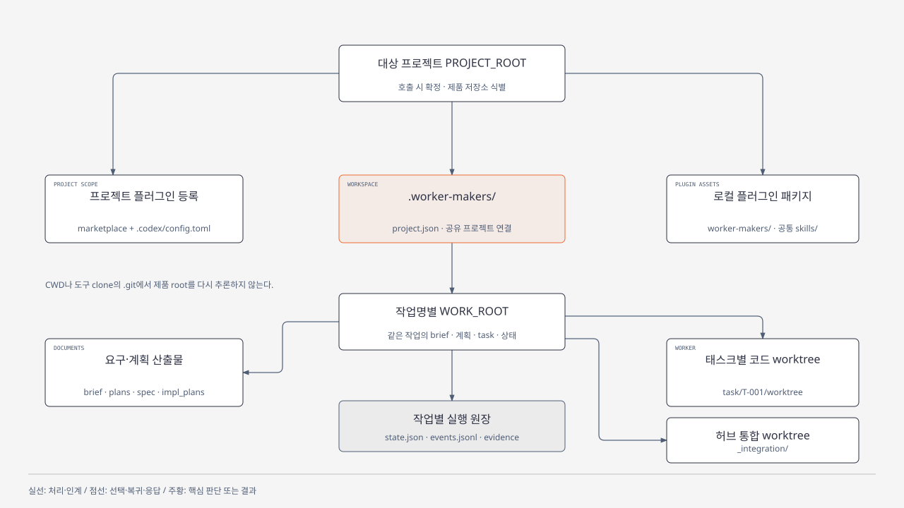

</details>

```text
<project-root>/
  .agents/plugins/marketplace.json  # Codex 설치 시
  .codex/config.toml                # Codex 설치 시
  .claude/settings.local.json       # Claude Code --scope local 설치 시
  worker-makers/                  # clone한 설치 원본
  .worker-makers/                 # 실행 산출물
    project.json
    <작업명>/
      workspace.json
      brief.md
      plans/  spec/  impl_plans/
      goal.md  goal.json  pre-work.md
      clarifications.md           # 질문이 있을 때
      state.json  events.jsonl
      revisions/  review/  evidence/
      _integration/<repo-id>/
      task/T-001/
        task.json  result.json
        attempts/  worktree/
```

설치 자산과 산출물을 분리합니다. `.worker-makers/`는 Git local exclude에 추가하며 제품 `.gitignore`는 바꾸지 않습니다. 원 checkout·사용자 변경을 보존하고 코드 수정은 task worktree, 통합/최종 검증은 integration worktree에서 수행합니다. 허브만 중앙 원장을 씁니다.

goal-maker는 [goal.json 계약](skills/goal-maker/references/goal-contract.md)을 함께 작성합니다. 문서 지문·완료 표식·수렴 근거·task/gate DAG·owns·기준 SHA를 검사합니다. 구조 검사는 실제 합의·리뷰 품질·명령 성공을 대신 증명하지 않습니다.

```powershell
python -X utf8 worker-makers/skills/work/scripts/wm.py --help
python -X utf8 worker-makers/skills/work/scripts/wm.py status --work <WORK_ROOT>
python -X utf8 worker-makers/skills/work/scripts/wm.py ready --work <WORK_ROOT>
```

준비·회수·통합·수정·복구·phase gate·정리는 [실행 규약](skills/work/references/execution.md), 모델은 [호스트 규약](skills/work/references/host-model.md), 코드/OWASP 관점 보안 리뷰와 완료는 [품질 규약](skills/work/references/quality.md)에 있습니다. 로컬 완료, 제품 branch 반영, 원격 발행은 구분합니다.

Git이 없거나 최초 커밋이 없으면 goal에 `kind: files`와 제품 파일 tree 지문을 기록해 같은 실행 도구를 사용합니다. Git 초기화/최초 커밋을 임의로 만들지 않습니다. files는 task별 격리 사본에서 개발하고 owns·기준/결과 지문을 대조해 직렬 통합합니다. 관리·인증 자산과 계획에 명시한 도구 clone/의존성은 사본에서 제외하며 원 제품은 보존합니다. 자세한 지문 명령과 제외 경로는 [인계 계약](skills/goal-maker/references/goal-contract.md)에 있습니다.

링크·특수 파일·파일↔디렉터리 전환은 자동 통합하지 않습니다. 강제 종료 시 captured 이동과 새 파일 게시 사이에 끊겼다면 보존된 백업을 확인해 복구 후 이어갑니다. 불명확한 사용자 변경을 덮어쓰지 않습니다. 같은 목표의 후속은 goal-maker에서 재수렴한 뒤 `adopt-goal`, 구현 수정은 `repair`, 실제 실행 상태/단계는 `set-status`/`set-stage`로 기록합니다.

## 개발과 검증

[AGENTS.md](AGENTS.md)를 따릅니다. 실행 도구 정본은 `skills/work/scripts/wm.py`이며 수정 후 독립 패키지에 같은 도구를 반영합니다.

```powershell
python -X utf8 scripts/build.py
python -X utf8 scripts/build.py --check
python -X utf8 scripts/check.py
claude plugin validate .
git diff --check
git status --short
```

패키지 검사는 배포 파일 목록·스킬 메타데이터·독립 상대 참조·runtime/bundle 일치와 Codex·Claude 매니페스트의 버전 일치를 확인합니다.

실행에 필요한 규약과 템플릿은 모두 `skills/`에 포함합니다.

## 라이선스

[MIT](LICENSE)
